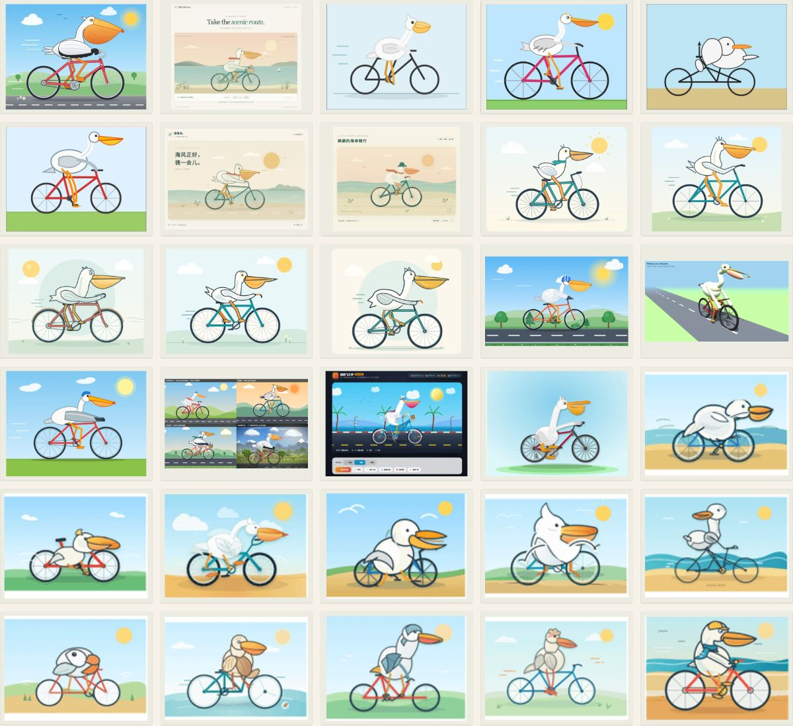
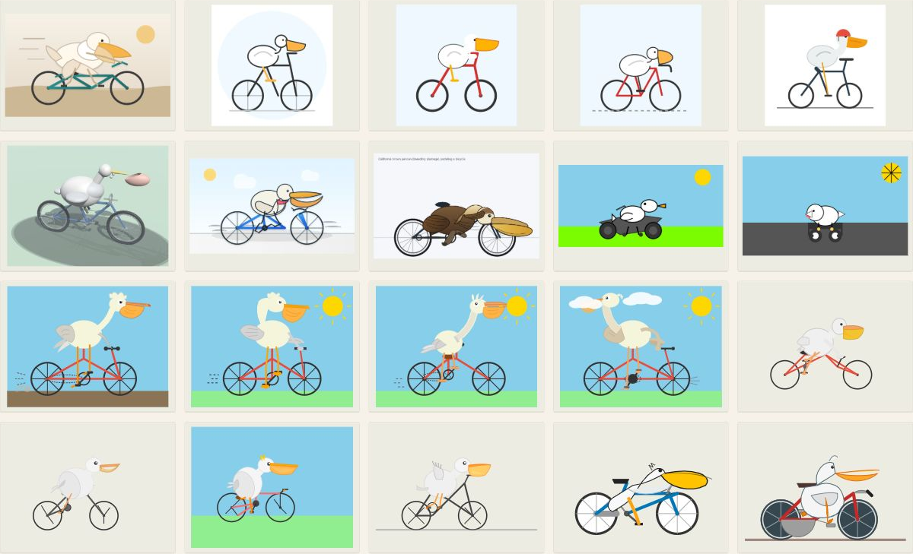

<p align="center"><a href="https://pelicanmap.aveniqa.com/specimens/?view=images"></a></p>

<p align="center"><a href="https://pelicanmap.aveniqa.com/specimens/?view=images">浏览馆藏 ↗</a> · <a href="https://unclek.github.io/pelicanmap/zh/">项目首页</a> · <a href="README.md">English</a></p>

**鹈鹕骑车标本馆**收藏大模型代码生成的鹈鹕骑车作品，覆盖各时间段与展示媒介。 保留真实输出、原始出处，也保留失败。代码生成的动画、三维、交互及录屏可以收；直接文生视频不进入主馆，旧记录与原媒体留作资料。

全部作品／普通搜索按作品记录日期最新在前；时间线按型号月份分组，同月优先显示有最新作品的型号，型号内按作品日期排列。核实发布日期另存 `modelTimeline.releaseDate`；缺少依据时用该标签最早计数作品月份暂定 `sortDate`，`estimatedFrom` 保留依据，估算不冒充发布事实，也不显示待核分区。时间线年份筛型号位置，全部作品仍筛作品年份；原始日期／编号保持，同一确切型号默认折叠，可展开。首页的 1988 年电影片段是人类制作的历史前例，不计 AI 作品，也不推定它启发了提示词。

<p align="center">
  <a href="https://pelicanmap.aveniqa.com/specimens/?view=images"></a>
  <a href="https://pelicanmap.aveniqa.com/timeline/"></a>
  <a href="https://unclek.github.io/pelicanmap/zh/#statistics"></a>
</p>

[在线统计图 ↗](https://unclek.github.io/pelicanmap/zh/#statistics) · 徽章自动读取在线接口，受图片缓存影响。时间线为作品子集，评分资料单列。

<!-- collection-stats:start -->
馆藏快照（2026-10-28）：**1,177** 件作品 · **1,021** 件常规作品 · **156** 件衍生作品。后两项是总数的分项。 [在线统计](https://pelicanmap.aveniqa.com/api/v1/stats) · 此区由 `npm run build:project` 自动生成。

<a href="https://pelicanmap.aveniqa.com/" lang="zh-CN">中文</a> · [English](https://pelicanmap.aveniqa.com/en/) · [Русский](https://pelicanmap.aveniqa.com/ru/) · [Português (Brasil)](https://pelicanmap.aveniqa.com/pt-BR/)
<!-- collection-stats:end -->

## 一个问题，一大群鹈鹕

<a href="https://pelicanmap.aveniqa.com/specimens/?view=images"></a>

```text
生成一张鹈鹕骑自行车的 SVG。
```

[纯图片](https://pelicanmap.aveniqa.com/specimens/?view=images) · [时间线](https://pelicanmap.aveniqa.com/timeline/) · [可玩演示](https://pelicanmap.aveniqa.com/play/) · [来源](https://pelicanmap.aveniqa.com/sources/) · [评分参考](https://pelicanmap.aveniqa.com/tags/benchmark/)

## 看看更早的回答

<a href="https://pelicanmap.aveniqa.com/specimens/?year=2025&view=images"></a>

原始媒体、作者与出处见各记录。模型按来源标注，未独立认证。[收录方法](https://pelicanmap.aveniqa.com/about/)。

全部作品按作品记录日期倒序；时间线按型号月份分组，同月优先显示最新作品；有发布证据时使用首次公开日期，否则按最早来源作品月份暂定位置，不显示待核分区，不改作品日期。同型号内按作品日期排列，同一确切型号默认折叠，可展开查看全部常规作品与档位；衍生单列。动态预览静音播放；真实补充帧不增加作品数。

## 数据与接口

```bash
curl 'https://pelicanmap.aveniqa.com/api/v1/specimens?q=Gemini&limit=3'
```

```text
MCP  https://pelicanmap.aveniqa.com/mcp
     search_specimens · get_specimen · get_timeline
```

[JSON](https://pelicanmap.aveniqa.com/data/catalog.json) · [CSV](https://pelicanmap.aveniqa.com/data/catalog.csv) · [OpenAPI](https://pelicanmap.aveniqa.com/openapi.json) · [Agent 导读](https://pelicanmap.aveniqa.com/llms.txt) · [接入文档](https://pelicanmap.aveniqa.com/developers/) · [接入示例](docs/INTEGRATIONS.zh-CN.md)

普通搜索、全部作品采用 `artwork-date`；`/api/v1/timeline` 与 `kind=timeline` 保留 `model-release` 型号月份轴，同月按 `latestArtworkDate`／`latestArtworkId` 排列，型号内按作品日期。这些最新作品字段不是模型发布日期；同日用稳定 ID 固定顺序。时间线年份筛型号位置，普通搜索年份筛作品年份；Play 保留作品日期排序。`counts.timeline` 是 `counts.cases` 的子集，不能相加。完整导出保留资料和 Benchmark；主馆须筛 `caseVisible`、`timelineVisible`、`referenceOnly`。新收录要求 `generationMethod=code-generated` 与公开 `codeGenerationEvidence`；不按视频后缀猜生成方式，旧直接文生视频可按 ID 查阅。

## 本地运行

```bash
git clone https://github.com/UncleK/pelicanmap.git
cd pelicanmap
npm ci
npm test
npm run start:api
```

需要 Node.js 24。仓库带公开目录快照和只读 API；完整构建另需原始归档。[开发说明](docs/DEVELOPMENT.md)。

原创代码 MIT；作品与上游资料沿用原作者许可。[来源与许可](NOTICE.md)。最初的题目来自 [Simon Willison](https://simonwillison.net/2024/Oct/25/pelicans-on-a-bicycle/)。

收录时保留完整原动画：HTML/CSS/JS、所需依赖及原模块一起归档，不把依赖外围动画代码的作品截成静态 SVG。已核动态作品在标准、紧凑、纯图片视图都用动态缩略图，可见时播放、离屏暂停，静态图只作后备。恢复动态保持原 ID、日期、署名和媒体，不增加作品计数。普通公开作品不以开源许可证为收录门槛；缺原件的情况明确记录，不自行编造运动。可复用规则与原件哈希见 [collecting-policy.json](site/collecting-policy.json) 和 [motion-restorations.json](site/motion-restorations.json)。
